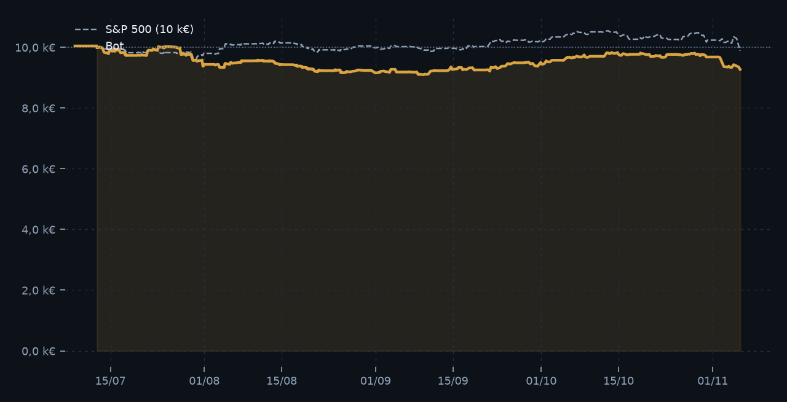

# 🧭 BOUSSOLE — bot 24h/24

**SIMULATION · cours réels · capital fictif** — mis à jour le 08/11/2026 à 20:46 (Paris) · sources : directes

## 🔴 9 303,77 €

**-696,23 € (-7,0 %)** · jour +0,0 % depuis le 12/07/2026

| Indicateur | Valeur | Indicateur | Valeur |
|---|---|---|---|
| Perf. annualisée | -19,8 % | Volatilité ann. | 10,6 % |
| Drawdown max | -9,0 % | Sharpe | -1,40 |
| Exposition | 82 % | Liquidités | 1 696,61 € |
| Trades clôturés | 118 (36 % gagnants) | Frais cumulés | 387,13 € |
| EUR/USD | 1,1138 | P&L réalisé | -801,72 € |

## Positions

| Actif | Qté | Cours | Valeur | P&L | Poids |
|---|---|---|---|---|---|
| **AAPL** Apple | 7,558 | 342,37 $ | 2 323,16 € | +2,0 % | 25 % |
| **DBC** Panier mat. prem. | 81,856 | 31,54 $ | 2 317,95 € | -2,4 % | 25 % |
| **MSFT** Microsoft | 3,659 | 530,61 $ | 1 743,06 € | +10,4 % | 19 % |
| **USO** Pétrole WTI | 9,178 | 148,41 $ | 1 222,99 € | -3,6 % | 13 % |

## Signaux (classement momentum)

| # | Actif | Momentum | Tendance | Cible |
|---|---|---|---|---|
| 1 | **MSFT** Microsoft | +17,0 % | ▲ | 20 % |
| 2 | **AAPL** Apple | +14,6 % | ▲ | 25 % |
| 3 | **USO** Pétrole WTI | +11,7 % | ▲ | 15 % |
| 4 | **DBC** Panier mat. prem. | +3,4 % | ▲ | 25 % |
| 5 | **JPM** JPMorgan | +1,9 % | ▽ | — |
| 6 | **META** Meta | +1,9 % | ▽ | — |
| 7 | **TLT** Obligations US 20 ans | -2,3 % | ▽ | — |
| 8 | **SPY** S&P 500 | -2,6 % | ▽ | — |

## Derniers ordres

| Date | Sens | Actif | Montant | P&L | Raison |
|---|---|---|---|---|---|
| 05/11 23:01 | VENTE | **JPM** | 2 083,69 € | -85,63 € | Filtre de tendance (< MM100) |
| 05/11 23:01 | ACHAT | **AAPL** | 384,99 € | — | Renforcement vers 25 % |
| 05/11 07:53 | VENTE | **META** | 1 445,87 € | -27,93 € | Filtre de tendance (< MM100) |
| 05/11 07:53 | ACHAT | **JPM** | 2 165,07 € | — | Entrée momentum · rang 4 |
| 04/11 19:00 | VENTE | **MSFT** | 534,50 € | +64,29 € | Allègement vers 19 % |
| 04/11 19:00 | VENTE | **AAPL** | 489,78 € | +22,08 € | Allègement vers 21 % |
| 04/11 19:00 | ACHAT | **META** | 1 470,88 € | — | Entrée momentum · rang 4 |
| 03/11 16:13 | ACHAT | **USO** | 391,90 € | — | Renforcement vers 14 % |
| 03/11 00:35 | VENTE | **SPY** | 2 050,73 € | -27,85 € | Filtre de tendance (< MM100) |
| 03/11 00:35 | ACHAT | **MSFT** | 481,89 € | — | Renforcement vers 23 % |
| 02/11 17:07 | VENTE | **USO** | 421,04 € | +14,27 € | Allègement vers 10 % |
| 02/11 17:07 | ACHAT | **SPY** | 2 074,46 € | — | Entrée momentum · rang 5 |

## Journal

- `08/11 16:16` — Portefeuille déjà aligné — aucun ordre
- `08/11 08:25` — Portefeuille déjà aligné — aucun ordre
- `08/11 01:40` — Portefeuille déjà aligné — aucun ordre
- `07/11 17:51` — Portefeuille déjà aligné — aucun ordre
- `07/11 11:17` — Portefeuille déjà aligné — aucun ordre
- `07/11 03:51` — Portefeuille déjà aligné — aucun ordre

---
_Stratégie : momentum 3 & 6 mois, filtre MM100, Top 5 pondéré inverse-volatilité (max 25 %/ligne), bande 4 %, frais 0,10 %/ordre (min 1 €), arbitrage au plus toutes les 6 h. Passage horaire via GitHub Actions._

_Outil pédagogique : aucun argent réel, aucune garantie de performance, pas un conseil en investissement._