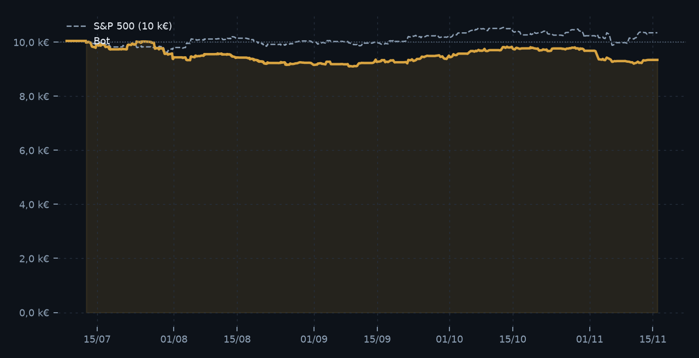

# 🧭 BOUSSOLE — bot 24h/24

**SIMULATION · cours réels · capital fictif** — mis à jour le 19/11/2026 à 04:33 (Paris) · sources : directes

## 🔴 9 076,21 €

**-923,79 € (-9,2 %)** · jour +0,1 % depuis le 12/07/2026

| Indicateur | Valeur | Indicateur | Valeur |
|---|---|---|---|
| Perf. annualisée | -23,9 % | Volatilité ann. | 10,7 % |
| Drawdown max | -9,5 % | Sharpe | -1,71 |
| Exposition | 77 % | Liquidités | 2 114,93 € |
| Trades clôturés | 130 (35 % gagnants) | Frais cumulés | 427,07 € |
| EUR/USD | 1,0963 | P&L réalisé | -1 145,12 € |

## Positions

| Actif | Qté | Cours | Valeur | P&L | Poids |
|---|---|---|---|---|---|
| **AAPL** Apple | 7,558 | 352,45 $ | 2 429,74 € | +6,7 % | 27 % |
| **AMZN** Amazon | 9,298 | 267,74 $ | 2 270,82 € | +0,0 % | 25 % |
| **MSFT** Microsoft | 4,876 | 508,29 $ | 2 260,72 € | +3,1 % | 25 % |

## Signaux (classement momentum)

| # | Actif | Momentum | Tendance | Cible |
|---|---|---|---|---|
| 1 | **AAPL** Apple | +14,7 % | ▲ | 25 % |
| 2 | **MSFT** Microsoft | +13,2 % | ▲ | 25 % |
| 3 | **META** Meta | +6,8 % | ▽ | — |
| 4 | **AMZN** Amazon | +1,6 % | ▲ | 25 % |
| 5 | **JPM** JPMorgan | -0,4 % | ▽ | — |
| 6 | **USO** Pétrole WTI | -1,7 % | ▽ | — |
| 7 | **SPY** S&P 500 | -3,2 % | ▽ | — |
| 8 | **TLT** Obligations US 20 ans | -3,5 % | ▽ | — |

## Derniers ordres

| Date | Sens | Actif | Montant | P&L | Raison |
|---|---|---|---|---|---|
| 18/11 22:59 | VENTE | **USO** | 2 091,29 € | -68,69 € | Momentum devenu négatif |
| 18/11 22:59 | ACHAT | **AMZN** | 2 267,92 € | — | Entrée momentum · rang 3 |
| 18/11 15:05 | ACHAT | **USO** | 2 155,73 € | — | Entrée momentum · rang 3 |
| 17/11 05:31 | VENTE | **USO** | 2 176,60 € | -63,53 € | Momentum devenu négatif |
| 16/11 23:09 | VENTE | **JPM** | 2 240,27 € | -52,40 € | Filtre de tendance (< MM100) |
| 16/11 23:09 | VENTE | **META** | 1 493,32 € | -36,12 € | Filtre de tendance (< MM100) |
| 16/11 23:09 | ACHAT | **USO** | 917,00 € | — | Renforcement vers 24 % |
| 16/11 23:09 | ACHAT | **MSFT** | 612,10 € | — | Renforcement vers 25 % |
| 13/11 23:40 | VENTE | **MSFT** | 636,76 € | +43,81 € | Allègement vers 18 % |
| 13/11 23:40 | VENTE | **USO** | 512,90 € | -5,73 € | Allègement vers 14 % |
| 13/11 23:40 | VENTE | **AMZN** | 1 975,41 € | +11,60 € | Sorti du Top 5 |
| 13/11 23:40 | ACHAT | **JPM** | 2 288,14 € | — | Entrée momentum · rang 4 |

## Journal

- `18/11 22:59` — 2 ordres exécutés
- `18/11 15:05` — 1 ordre exécuté
- `17/11 23:55` — Portefeuille déjà aligné — aucun ordre
- `17/11 15:29` — Portefeuille déjà aligné — aucun ordre
- `17/11 05:31` — 1 ordre exécuté
- `16/11 23:09` — 4 ordres exécutés

---
_Stratégie : momentum 3 & 6 mois, filtre MM100, Top 5 pondéré inverse-volatilité (max 25 %/ligne), bande 4 %, frais 0,10 %/ordre (min 1 €), arbitrage au plus toutes les 6 h. Passage horaire via GitHub Actions._

_Outil pédagogique : aucun argent réel, aucune garantie de performance, pas un conseil en investissement._