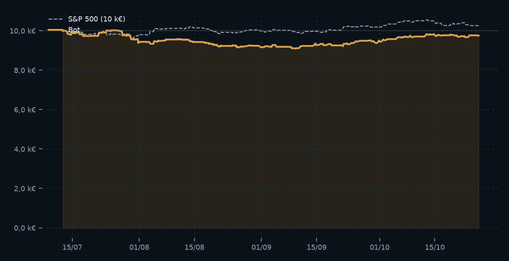

# 🧭 BOUSSOLE — bot 24h/24

**SIMULATION · cours réels · capital fictif** — mis à jour le 21/10/2026 à 01:55 (Paris) · sources : directes

## 🔴 9 696,61 €

**-303,39 € (-3,0 %)** · jour +0,1 % depuis le 12/07/2026

| Indicateur | Valeur | Indicateur | Valeur |
|---|---|---|---|
| Perf. annualisée | -10,6 % | Volatilité ann. | 10,3 % |
| Drawdown max | -9,0 % | Sharpe | -0,70 |
| Exposition | 94 % | Liquidités | 600,16 € |
| Trades clôturés | 102 (32 % gagnants) | Frais cumulés | 343,21 € |
| EUR/USD | 1,1230 | P&L réalisé | -807,18 € |

## Positions

| Actif | Qté | Cours | Valeur | P&L | Poids |
|---|---|---|---|---|---|
| **AAPL** Apple | 8,112 | 339,50 $ | 2 452,48 € | +2,9 % | 25 % |
| **DBC** Panier mat. prem. | 81,856 | 33,57 $ | 2 446,93 € | +3,0 % | 25 % |
| **MSFT** Microsoft | 3,999 | 531,87 $ | 1 893,84 € | +15,7 % | 20 % |
| **USO** Pétrole WTI | 8,949 | 160,61 $ | 1 279,85 € | +10,9 % | 13 % |
| **META** Meta | 1,655 | 694,25 $ | 1 023,34 € | -1,8 % | 11 % |

## Signaux (classement momentum)

| # | Actif | Momentum | Tendance | Cible |
|---|---|---|---|---|
| 1 | **MSFT** Microsoft | +30,8 % | ▲ | 20 % |
| 2 | **USO** Pétrole WTI | +23,6 % | ▲ | 12 % |
| 3 | **AAPL** Apple | +15,9 % | ▲ | 25 % |
| 4 | **DBC** Panier mat. prem. | +13,7 % | ▲ | 25 % |
| 5 | **META** Meta | +7,2 % | ▲ | 11 % |
| 6 | **QQQ** Nasdaq 100 | +6,6 % | ▽ | — |
| 7 | **AMZN** Amazon | +6,2 % | ▲ | — |
| 8 | **SPY** S&P 500 | +6,1 % | ▲ | — |

## Derniers ordres

| Date | Sens | Actif | Montant | P&L | Raison |
|---|---|---|---|---|---|
| 20/10 02:23 | VENTE | **NVDA** | 1 567,04 € | -19,39 € | Sorti du Top 5 |
| 20/10 02:23 | ACHAT | **META** | 1 040,76 € | — | Entrée momentum · rang 5 |
| 19/10 17:40 | VENTE | **META** | 756,09 € | -67,28 € | Sorti du Top 5 |
| 19/10 17:40 | ACHAT | **NVDA** | 1 583,28 € | — | Entrée momentum · rang 5 |
| 13/10 18:02 | VENTE | **QQQ** | 1 729,35 € | -12,77 € | Sorti du Top 5 |
| 13/10 18:02 | ACHAT | **META** | 821,37 € | — | Entrée momentum · rang 5 |
| 13/10 09:45 | VENTE | **META** | 835,17 € | -10,71 € | Sorti du Top 5 |
| 13/10 09:45 | ACHAT | **QQQ** | 1 738,66 € | — | Entrée momentum · rang 5 |
| 12/10 19:58 | VENTE | **NVDA** | 1 696,53 € | +10,36 € | Sorti du Top 5 |
| 12/10 19:58 | ACHAT | **META** | 843,88 € | — | Entrée momentum · rang 5 |
| 08/10 03:59 | VENTE | **MSFT** | 414,48 € | +54,37 € | Allègement vers 20 % |
| 08/10 03:59 | VENTE | **META** | 925,16 € | +30,01 € | Sorti du Top 5 |

## Journal

- `20/10 22:38` — Portefeuille déjà aligné — aucun ordre
- `20/10 13:43` — Portefeuille déjà aligné — aucun ordre
- `20/10 02:23` — 2 ordres exécutés
- `19/10 17:40` — 2 ordres exécutés
- `19/10 09:51` — Portefeuille déjà aligné — aucun ordre
- `19/10 03:23` — Portefeuille déjà aligné — aucun ordre

---
_Stratégie : momentum 3 & 6 mois, filtre MM100, Top 5 pondéré inverse-volatilité (max 25 %/ligne), bande 4 %, frais 0,10 %/ordre (min 1 €), arbitrage au plus toutes les 6 h. Passage horaire via GitHub Actions._

_Outil pédagogique : aucun argent réel, aucune garantie de performance, pas un conseil en investissement._